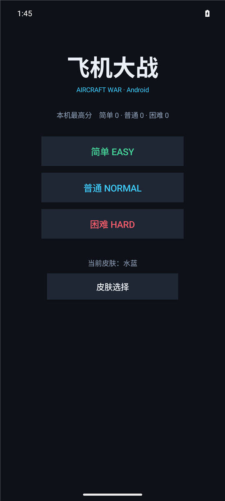
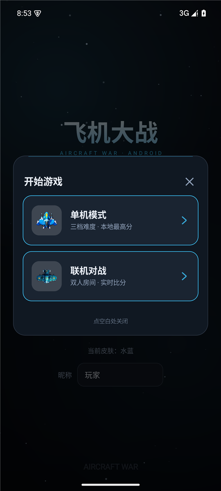
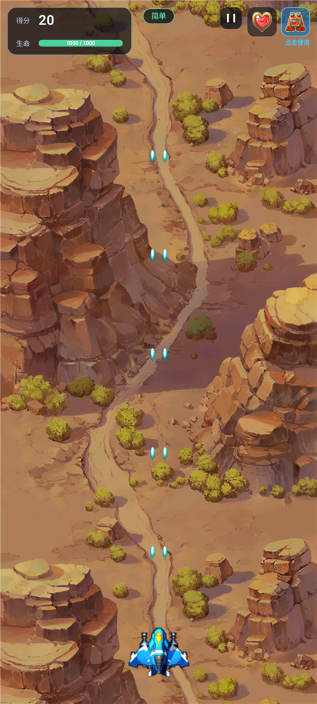
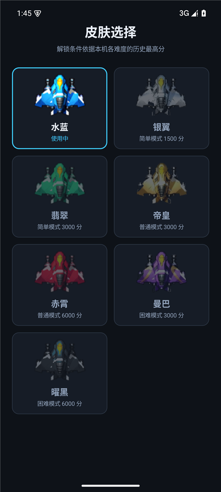
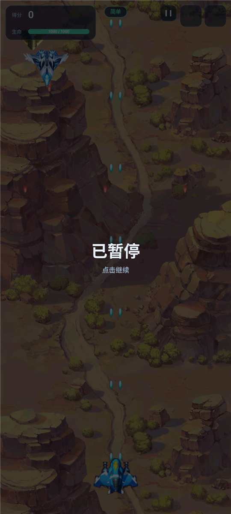
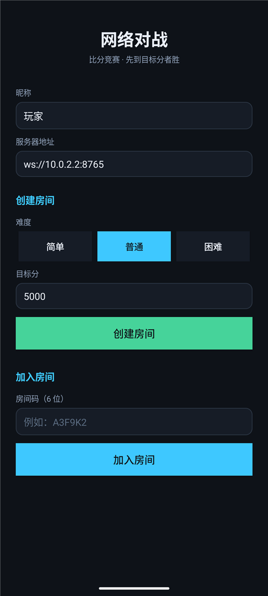

# 飞机大战 · Android 版（AircraftWar-Android）

> 《软件构造实践》第二学期实验项目 —— 把 Windows 版飞机大战（Java Swing）迁移到 Android，
> 并在此基础上实现网络对战。
>
> 课程：哈尔滨工业大学（深圳）· 软件构造实践 · 2026 秋
> 仓库：Gitee `git@gitee.com:stardropflower/air-battle-android-version.git`（**验收以此为准**）
> 同步镜像：GitHub `https://github.com/Stardropflower/aircraftwar-android`

## 当前状态

| 实验 | 学时 | 内容 | 提交物 | 状态 |
|------|------|------|--------|------|
| 一 | 2 | Android 开发技术 | **任务书** | ✅ 已提交 → [任务书](docs/01-任务书.md) |
| 二 | 4 | 代码迁移 | 程序 | ✅ 完成，模拟器实测通过 |
| 三 | 4 | 界面与音效 | 程序 | ✅ 完成（含音乐/音效开关、XML 与自绘两套界面） |
| 四 | 4 | 排行榜与存储 | 程序 | ✅ 完成（ListView + BaseAdapter + SQLite + 删除） |
| 五 | 4 | 网络对战 | 程序 | 🟡 已实现并合入主分支，**不在中期验收范围** |
| 六 | 2 | 扩展功能 | 程序 | ⬜ 未开始 |
| 七 | 4 | 结题验收 | 结题报告 | ⬜ 未开始 |

> **中期检查范围是实验一～四**。实验五（网络对战）的代码已经合入主线，
> 但验收时不作为考核内容，仅作为"已完成工作"介绍。

## 界面

| 主菜单 | 开始面板（二级） | 游戏内 |
|---|---|---|
|  |  |  |

菜单为**二级结构**：主界面四个入口（开始游戏 / 皮肤选择 / 排行榜 / 设置），
点「开始游戏」弹出面板再选单机或联机。三层视觉都是纯代码自绘、不依赖图片资源：

- `ui/visual/StarfieldView` —— 常驻的动态星空背景
- `ui/visual/IntroOverlayView` —— 冷启动开场动画（只在 Activity 新建时播一次）
- `ui/visual/MenuOverlayView` —— 二级弹出面板，绘制与点击命中共用同一套矩形，不会"画在这里、点在那里"

| 皮肤选择 | 暂停 | 网络对战（实验五） |
|---|---|---|
|  |  |  |

## 已实现的功能

### 单机玩法（实验二～四）

- **核心逻辑层**：`core/` **43 个类**，**零 Android 依赖**，22 项 JVM 单元测试全绿
  （Boss / 炸弹 / 冰冻 / 背包 / 双人归属等规则与 Windows 版一致）
- **渲染与主循环**：`SurfaceView` + 独立渲染线程，逻辑 **25Hz** + 渲染 60fps 插值
- **界面**：主菜单（XML 布局）+ 三层自绘视觉 + 皮肤选择 + 排行榜 + 游戏内 HUD
- **音效**：`SoundPool` 放 4 种音效、`MediaPlayer` 放 2 首 BGM，Boss 自动换曲；
  实验三要求放 `res/raw`；音乐与音效**各自独立**开关（设置面板里）
- **背包**：点右上角道具格使用（最右格高亮＝下次会用这个）；英雄机被限制不能进顶部 UI 区
- **操作**：拖动控制（按下不移动、位移超阈值才跟随），避免小屏点道具时误判成移动
- **排行榜**：`ListView` + 自定义 `BaseAdapter`（复用 `convertView` + `ViewHolder`），
  第一名高亮，行末可删除，数据存 **SQLite**，按难度分开展示
- **结算**：撞机 / 点返回键 / 暂停菜单里返回，都会**立刻结算**入库

### 网络对战（实验五，已合入但不在验收范围）

- 房间制**比分竞赛**：只同步分数与血量，胜负由服务端权威判定
- 客户端：`net/BattleSession`（每秒上报、15s 心跳、断线重连）、`net/BattleRoomActivity`（创建/加入房间）
- 服务端：`server/` 目录，Node.js + `ws`，含房间管理与 60 秒重连宽限
- 附 `server/README.md` 说明如何启动

## 技术选型

| 维度 | 选择 | 理由 |
|------|------|------|
| 语言 | **Java**（不用 Kotlin） | 源项目是 Java，可复用部分能原样搬；换 Kotlin 平白增加重写与互操作成本 |
| 渲染 | **SurfaceView + Canvas**，独立渲染线程 | 2D 逐帧重绘标准做法；逻辑 25Hz + 渲染 60fps 插值 |
| 输入 | `MotionEvent`（拖动跟随 + 位移阈值） | 触屏替代鼠标；阈值避免误触把飞机瞬移到顶部 |
| 音效 | `SoundPool`（短音效）+ `MediaPlayer`（BGM），资源在 `res/raw` | 替代 `javax.sound.sampled.Clip` |
| 本地存储 | `SharedPreferences`（单值）+ **SQLite**（排行榜） | 替代 Java 对象序列化的 `.dat`；排行榜要排序与删除，必须用结构化存储 |
| 网络 | **OkHttp + WebSocket**，JSON 用 Gson | ⚠️ Android **没有** `java.net.http`，源项目的 HttpClient 必须替换 |
| 贴图 | `res/drawable-nodpi`，3 倍分辨率，**碰撞框钉死逻辑尺寸** | 高清图不被系统按密度缩放；碰撞框与贴图分辨率解耦，换图不改玩法 |

## 工程结构

```
app/src/main/java/edu/hitsz/aircraftwar/
├── core/          43 个类 —— 游戏规则（纯 Java，零 Android 依赖，可单测）
├── render/         3 个类 —— SurfaceView 渲染、主循环、触屏、资源加载
├── audio/          1 个类 —— SoundManager（SoundPool + MediaPlayer）
├── data/           1 个类 —— LocalStore（SharedPreferences）
├── db/             3 个类 —— 排行榜 SQLite（记录 / Helper / DAO）
├── net/            4 个类 —— 网络对战（实验五）
└── ui/            11 个类 —— Activity、Adapter、系统栏适配
    └── visual/     5 个类 —— 自绘菜单、星空、开场动画、皮肤预览、渐变文字

app/src/main/res/
├── drawable-nodpi/    22 张游戏图片（全小写，禁止密度缩放）
├── drawable/          矢量图标与按钮背景
├── layout/            activity_main / activity_rank / item_rank
├── raw/               7 个音频（bgm / bgm_boss / bullet_hit / bomb_explosion / get_supply / game_over / game_over_ori）
└── values/            colors / strings / themes

server/                Node.js + ws 对战服务端（实验五）
docs/                  实验文档与截图
guide/                 验收、上手、队友对接文档
```

## 本地构建

> 📍 **仓库必须放在纯 ASCII 路径下**（当前 `L:\android-projects\AircraftWar-Android`）。
> 放在中文目录时 AGP 会拒绝构建；即使绕过检查，单元测试也会 `ClassNotFoundException`（已实测）。
> 详见 [构建环境说明](docs/04-构建环境说明.md)。

```powershell
$env:JAVA_HOME    = "L:\android-toolchain\android-studio\jbr"   # AGP 8.x 支持上限是 JDK 21
$env:ANDROID_HOME = "L:\android-sdk"
cd L:\android-projects\AircraftWar-Android

# 编译 + 跑单元测试
& "L:\android-toolchain\gradle-8.11.1\bin\gradle.bat" assembleDebug --console=plain
& "L:\android-toolchain\gradle-8.11.1\bin\gradle.bat" testDebugUnitTest --console=plain

# 装到手机/模拟器
& "L:\android-sdk\platform-tools\adb.exe" install -r app\build\outputs\apk\debug\app-debug.apk
```

工具链：**Android Studio 2025.3.1（Panda）** + 自带 JBR 21、Android SDK 35、Gradle 8.11.1。
`minSdk 33` / `targetSdk 35` / `compileSdk 35`，项目名 `AircraftWar2026`。

> 📱 **`minSdk 33` 意味着只能装在 Android 13 及以上**。在更旧的手机上安装会提示
> 「解析软件包时出现问题」——不是安装包损坏。要在旧机上演示，用兼容构建：
> ```bash
> gradlew assembleDebug -PminSdkOverride=24    # 产出可装到 Android 7.0+
> ```
> 该参数只影响这一次构建，`build.gradle` 里的默认值仍是 33（课程要求）。

> ⚠️ 仓库里没有 Gradle Wrapper。Android Studio 若提示生成，注意它会默认指向较新版本
> （例如 Gradle 9），与本项目使用的 AGP 8.7.3 不匹配，可能构建失败。
> 用本机已装好的 Gradle 8.11.1 即可。

### 真机联机（已实测打通）

前提：**两台手机和跑服务端的电脑在同一个 WiFi / 局域网**。

```bash
# 1. 电脑上启动服务端（Windows 直接双击 server\start-server.bat 更省事）
cd server
npm install        # 只需第一次
npm start          # 监听 8765，看到「ws://0.0.0.0:8765」即成功

# 2. 查电脑的局域网 IP
ipconfig           # 找「IPv4 地址」，例如 10.250.115.81
```

> Windows 上双击 `server\start-server.bat` 可一步到位：自动装依赖、检查端口，
> 并直接打印出手机该填的那条 `ws://…`（标了「手机填这个」）。
> 若 PowerShell 报 `npm.ps1 因为在此系统上禁止运行脚本`，改用 `npm.cmd start`，
> 或 `Set-ExecutionPolicy -Scope CurrentUser RemoteSigned`（不需要管理员）。

3. 两台手机上进入 **开始游戏 → 联机对战**，把「服务器地址」改成
   `ws://<电脑IP>:8765`（填过一次会自动记住）
4. 一人点「创建房间」拿到 **6 位房间码**，另一人点「加入房间」输入它
5. 双方自动进入对局，HUD 上会实时显示对手的分数与生命

> 🔧 游戏内**联机页右上角有「使用教程」按钮**，上面这套步骤和常见故障排查都写在里面，
> 不用另外翻文档。

> ⚠️ **客户端为什么需要放开明文流量**：对战用的是 `ws://`，而 Android 9+ 默认禁止明文。
> 项目已通过 `res/xml/network_security_config.xml` 放开（见该文件注释）。
> 如果换成对外发布，应给服务端配 TLS 并改用 `wss://`。

模拟器调试时服务器地址填 `ws://10.0.2.2:8765`（`10.0.2.2` 是模拟器访问宿主机的固定地址）。

> 💡 校园网/公司网若做了**终端隔离**（手机连不上电脑），可以改用 USB：
> 电脑执行 `adb reverse tcp:8765 tcp:8765`，手机地址填 `ws://127.0.0.1:8765`。

## 分支约定

| 分支 | 用途 |
|---|---|
| `main` | 主分支，验收以此为准 |
| `feat/opening-animation` | 主菜单视觉改版（已合入 main） |
| `feat/net-battle` | 网络对战（已合入 main） |

## 文档索引

### 实验文档（`docs/`）

- [课程要求摘要](docs/00-课程要求摘要.md) — 从课件提炼的实验安排与技术要点
- [任务书](docs/01-任务书.md) — 实验一提交物
- [迁移分析](docs/02-迁移分析.md) — 逐模块的「可复用 / 需重新适配」判定与原因
- [项目计划书](docs/03-项目计划书.md) — 范围决策与网络功能设计
- [构建环境说明](docs/04-构建环境说明.md) — 工具链版本、ASCII 路径约束、构建命令
- [AI 使用日志](docs/05-AI使用日志.md) — 求助内容、采纳与未采纳的建议
- [实验二要求对照](docs/06-实验二要求对照.md) — 课件要求逐条自查
- [实验三/四要求对照](docs/07-实验三四要求对照.md) — 含 Supabase 与 SQLite 的分工说明

### 上手与验收（`guide/`）

- [代码阅读指南](guide/01-代码阅读指南.md) — 通俗讲三层架构与核心设计决策（理论篇）
- [界面与渲染导读](guide/06-界面与渲染导读.md) — 配套篇：每个类、每段代码干什么，**40 分钟读完**；含「一天怎么准备」时间表、15 个必背问答，第四章专讲「逻辑 25Hz + 渲染 60fps」
- [使用教程](guide/02-使用教程.md) — 构建、安装、游玩、故障排查
- [验收问答准备](guide/03-验收问答准备.md) — 常见提问与答法
- [队友入手指南](guide/04-队友入手指南.md) — 网络对战开发的接入说明
- [中期检查入手指南](guide/05-中期检查入手指南.md) — **四个实验**的课件知识点逐条对应到代码 + 演示脚本 + 30 个追问

## 与 Windows 版的关系

Windows 版（`https://github.com/Stardropflower/aircraftwar`，private）继续维护，作为迁移的对照基准：

- 它是本次迁移的**功能规格来源**（玩法、数值、Boss 规则、皮肤解锁等均已成型）
- Android 侧遇到规则歧义时，以 Windows 版行为为准
- 两者共享同一套 Supabase 表结构，**云端排行榜可跨端互通**（后续实验）
